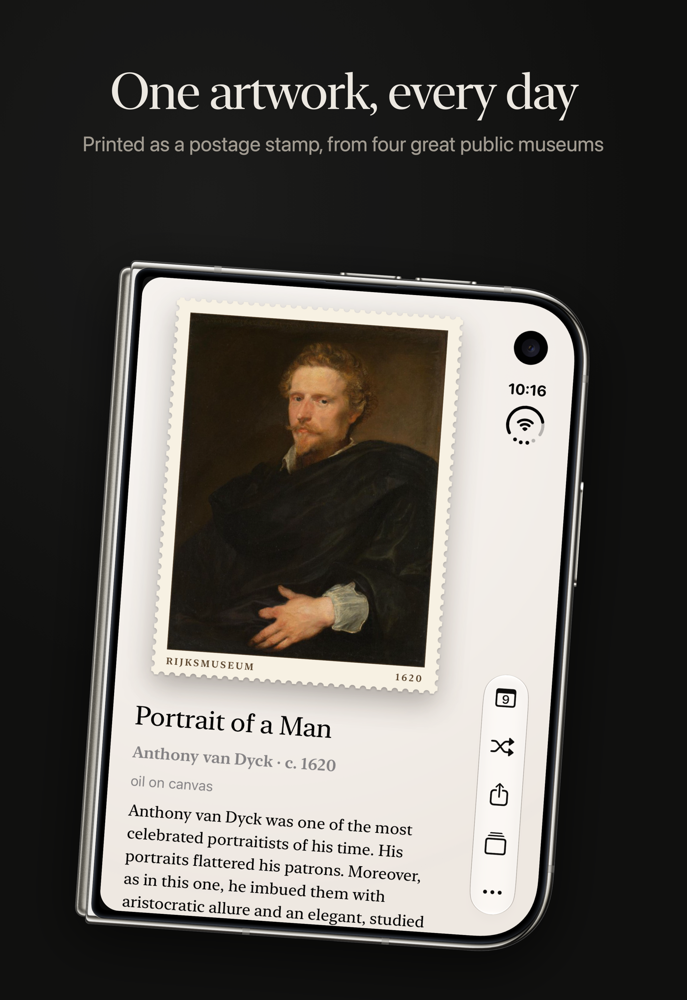
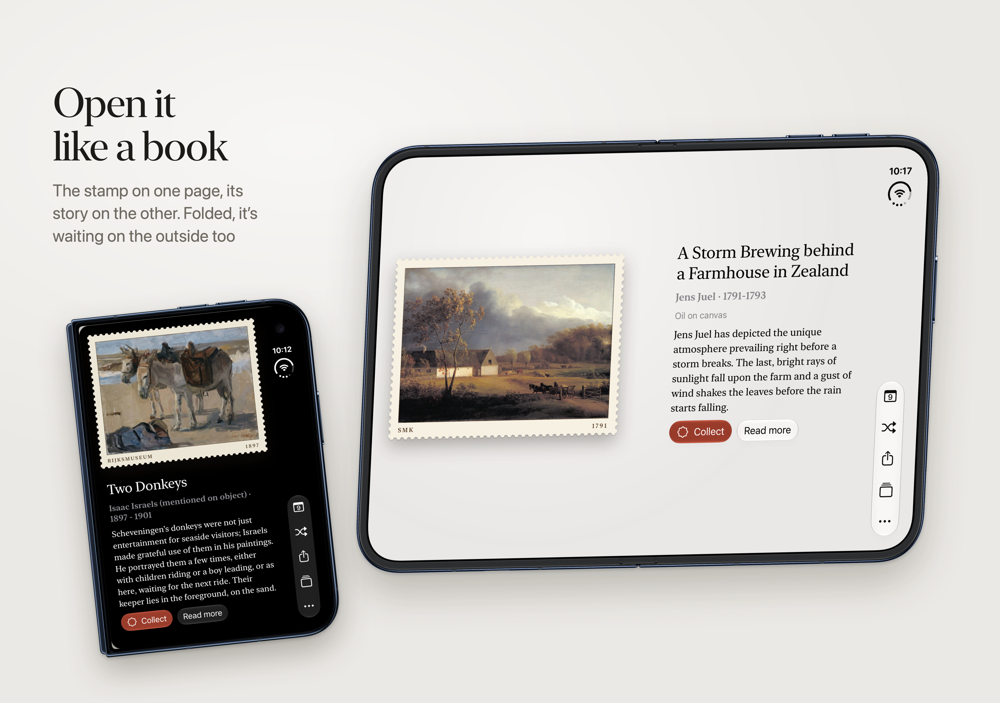

+++
title      = "building an elegant app"
date       = "2026-11-11"
draft      = false
categories = ["art", "tech"]
+++

i've been working on [artstamps](https://artstamps.fffelipe.com/#/today), it's a silly little project that shows one artwork a day from open museum collections (V&A, Art Institute of Chicago, Cleveland, SMK, Rijksmuseum), styled as a postage stamp. It ships as a website and as an iPhone app with widgets. I'm specially proud of the duo implementation, it looks really neat!

This is what it looks like folded:

And this is unfolded (sorry for the bad mockup, the real thing looks so much better):

If you care about technology, here are some more details on the project:

**No backend.** Both clients call the museums’ public APIs directly. The site only serves static files from a Cloudflare Worker, and a push to `main` deploys it. Since anything I ship is public, there are no API keys anywhere.

**Shared core.** Each museum has an adapter that maps its API onto one `Artwork` model. The “artwork of the day” is deterministic: everyone gets the same one and nothing is stored on a server. It comes from curated, append-only ID pools plus a rotation of “eras”. Day N of an era shows museum N mod k, and each museum steps through its own pool. You can only add eras dated in the future, so a date never changes after people have seen it.

**The website is** Vite + TypeScript with no UI framework, about 12 KB of gzipped JS. The stamp has perforations, tilt and glare, a wall colour taken from the art, swipe-to-shuffle and a zoom to fullscreen. Artworks are cached for 7 days and requests are spaced at least 1.5 s apart, so a visit costs about one API call.

**The iPhone app is** SwiftUI on iOS 26, with Home Screen, Lock Screen and StandBy widgets that share a cache through an App Group. The TypeScript is the reference implementation. The Swift port is checked against golden files that the TS generates, so both platforms pick and parse the same way. The app loads a manifest from our site to get rotation updates without an App Store release. An “album” keeps collected stamps fully offline.

**Constraints.** I'm deliberately light on museum APIs: a phone in steady state makes about one record request and one image request a day. Requests identify themselves honestly (no browser spoofing). Museum text is never rendered as HTML, and licences are checked both when a pool is built and again when a record loads.

Either way, if only for the novelty of it, you should try it! If you do, let me know what you think at hi@fffelipe.com (:

> [!NOTE] edit
> saturday, november 11th 2026: made minor corrections to the text.